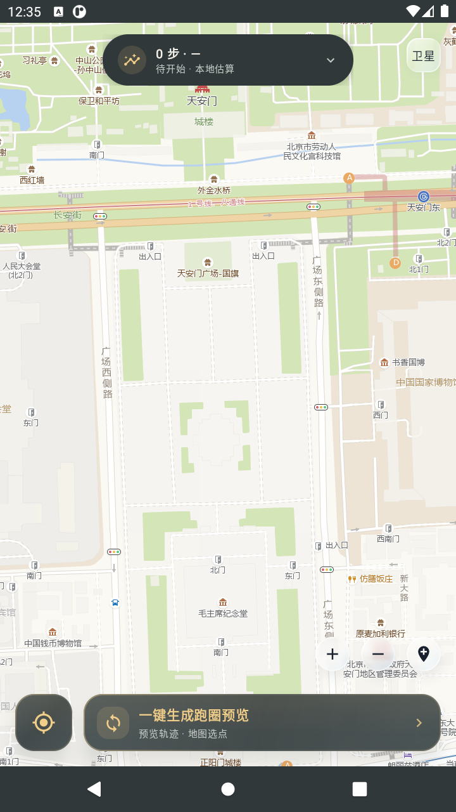
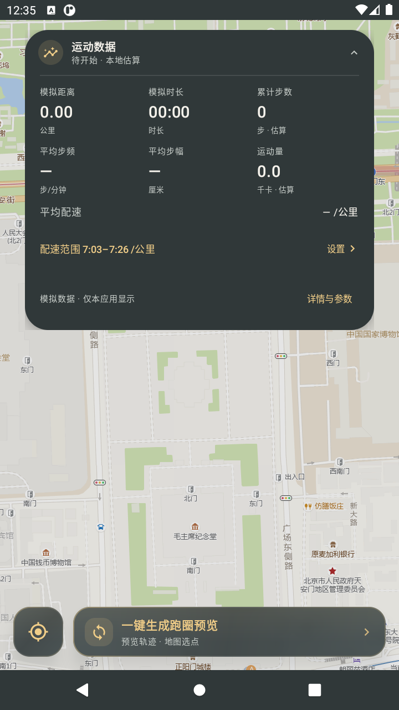
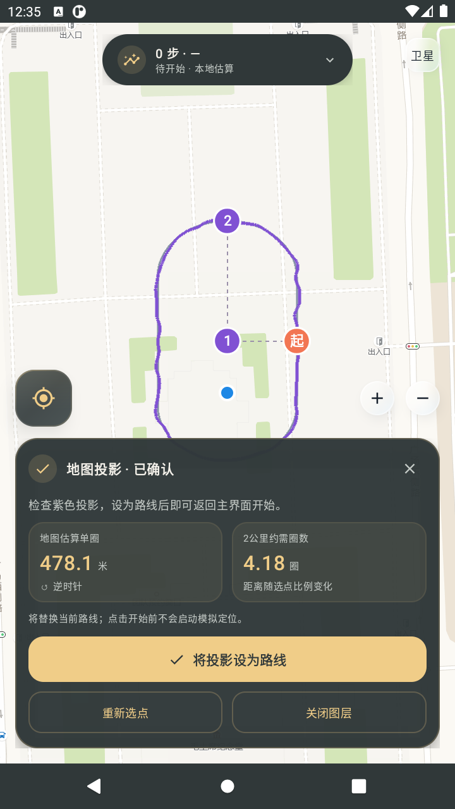
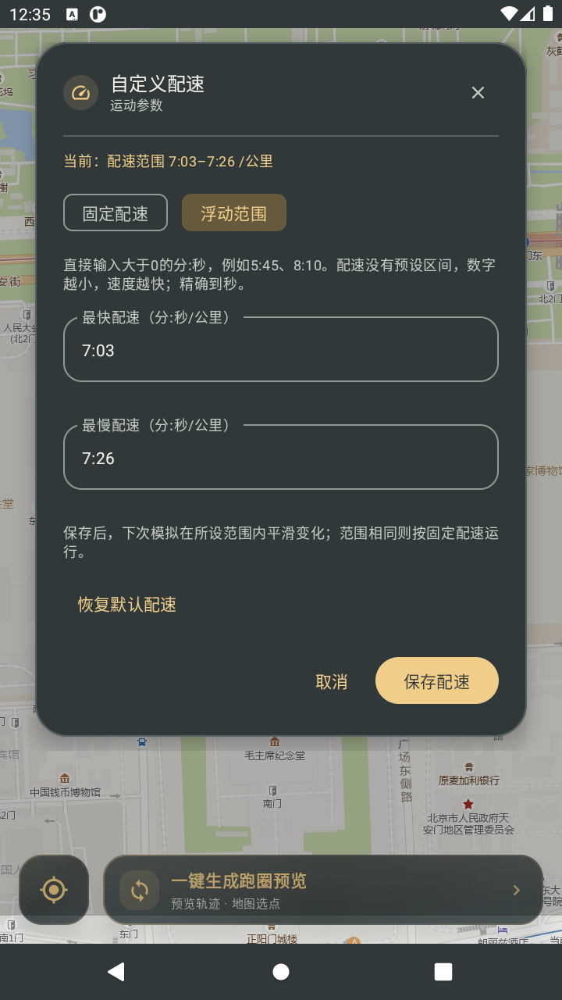

# VirtualRun Metrics

An Android app for designing loop routes, previewing trajectories, and testing mock-location behavior. It combines a map-based route workflow, customizable pace, local simulation metrics, and an animated floating dashboard.

| Property | Value |
| --- | --- |
| Current version | `1.0.5-metrics.22` |
| Minimum Android version | Android 8.0 / API 26 |
| App interface | Simplified Chinese |
| Documentation | English |

## Features

- **Route preview and projection:** Generate a synthetic loop, place three reference points on the map, review its scale and direction, and import it as a closed route.
- **Custom pace:** Enter any valid positive minutes-and-seconds pace, either as a fixed value or a fastest/slowest range. Settings apply to the next simulation.
- **Local metrics:** Display simulated distance and duration, plus estimated steps, cadence, stride length, and calories.
- **Floating dashboard:** Expand the compact island to inspect all metrics and parameters.
- **Coordinated interface:** Warm-gray glass surfaces, warm-gold accents, animated dialogs, and a stop button that moves smoothly to the center during playback.
- **Map controls:** Switch between road and satellite maps, zoom, locate the device, and select reference points.
- **Reliable map switching:** Independent providers and cache namespaces prevent tiles from different map modes from mixing.
- **High zoom:** Fetch native tiles through zoom 18 and crop/enlarge parent tiles for display through zoom 22.
- **Readable overlays:** Reduce basemap saturation to 72% while preserving route and location-marker colors.
- **Mock-location playback:** Use a foreground service with independent location delivery and diagnostics.

## Demo gallery

The screenshots below use the public map area around **Tiananmen Square, Beijing**. They show synthetic demonstrations, not a recorded visit, measured route, or real workout.

| Map and controls | Expanded dashboard |
| --- | --- |
|  |  |

| Three-point projection | Custom pace |
| --- | --- |
|  |  |

Basemap imagery is provided by AMap. Enlarged zoom levels cannot add detail beyond the original imagery.

## Install

Download the APK from [Releases](https://github.com/Zericyu/VirtualRun-Metrics/releases/latest). This repository is private, so downloads require access to the repository.

1. Install the APK and grant the requested location permissions.
2. Enable Android Developer options.
3. Select this app under **Select mock location app**.
4. Allow the foreground service to run when testing background playback.

Release APKs are development builds. A locally rebuilt debug APK may use a different signing key from the downloadable APK. Private signing keys and machine-specific configuration are not included in this repository.

## Use

1. Open the loop-preview action at the bottom of the map.
2. Select a direction and confirm the preview.
3. On the map, select the field center, a long-axis endpoint, and a side midpoint.
4. Review the projected outline and estimated lap length, then confirm it.
5. Import the projection as the route. The **Start** action becomes available after this step.
6. Expand the floating dashboard to set a fixed pace or a pace range.
7. Start the simulation. The centered **Stop** action ends playback immediately.

Examples of valid pace inputs are `5:45`, `6:00`, and `40:00`. A smaller value means a faster pace. Pace cannot be edited during playback; stop first and save the settings for the next run.

See [Usage](docs/usage.md) and [Architecture](docs/architecture.md) for details.

## Build and validate

Requirements:

- JDK 17
- Android SDK Platform 34 and the matching Android build tools
- An internet connection for the first dependency download

The Gradle wrapper is included.

```bash
./gradlew testDebugUnitTest lintDebug assembleDebug
```

On Windows:

```powershell
.\gradlew.bat testDebugUnitTest lintDebug assembleDebug
```

The APK is generated at:

```text
app/build/outputs/apk/debug/app-debug.apk
```

The test suite covers pace parsing and bounds, trajectory continuity, projection geometry, overzoom calculations, route import, delivery backoff, and local metric calculations. See [CHANGELOG.md](CHANGELOG.md) for the current changes.

## Simulation behavior

Mock locations and local estimates are test data. They do not establish physical movement or a real workout. Step, stride, cadence, and calorie estimates remain inside this app; they are not written to step sensors or third-party workout records. Other apps may handle mock-location data differently.

Map display uses GCJ-02 coordinates. The location layer converts coordinates when exchanging positions with Android's WGS-84 location providers.

## Upstream and license

Based on [uinaqx/VirtualGPS-Run---MAX](https://github.com/uinaqx/VirtualGPS-Run---MAX). This repository contains a customized development branch with additional route, pace, metrics, and interface work.

The project is distributed under the [MIT License](LICENSE). The original copyright and license notices are retained.
